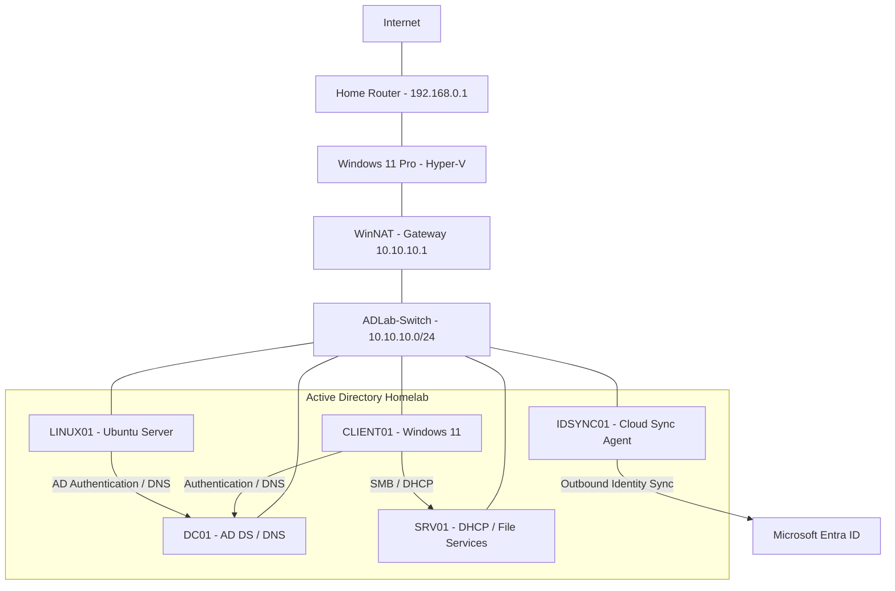

# Active Directory Enterprise Lab

A hybrid enterprise homelab built using Hyper-V, Windows Server 2025, Windows 11 Enterprise, Ubuntu Server, Active Directory Domain Services, and Microsoft Entra ID.

The goal of this project is to develop practical experience in systems administration, networking, identity management, automation, security, and troubleshooting.

## Lab Overview

| System | Role |
|---|---|
| DC01 | Active Directory Domain Services, DNS |
| SRV01 | DHCP, File Services |
| CLIENT01 | Windows 11 domain workstation |
| LINUX01 | Ubuntu Server, AD authentication |
| IDSYNC01 | Microsoft Entra Cloud Sync |
| Windows 11 Host | Hyper-V and NAT |

**Domain:** `corp.adlab.test`  
**Lab Network:** `10.10.10.0/24`

## Features Implemented

- Active Directory Domain Services and DNS
- DHCP and Windows domain joining
- Organizational Units, users, and security groups
- Group Policy and workstation configuration
- SMB file sharing and NTFS permissions
- User provisioning with PowerShell scripts
- Hyper-V virtual networking and NAT
- Ubuntu Server Active Directory integration
- Microsoft Entra Cloud Sync
- Hybrid identity management
- Troubleshooting and documentation

## Role-Based Access Demonstration

Department shares on SRV01 are protected with AD security groups using the AGDLP model. A member of the Finance group can open and edit files on `\\SRV01\Finance`, while a user outside Finance is denied. 

Each user also only sees their own department’s drive, mapped by Group Policy.

<table>
  <tr>
    <td width="50%"></td>
    <td width="50%"></td>
  </tr>
  <tr>
    <td align="center"><b>Authorized:</b> A Finance user is able to view, create and edit a text file</td>
    <td align="center"><b>Denied:</b> An IT user trying to access Finance is blocked</td>
  </tr>
</table>

See [File Services](./docs/file-services.md) for the full permission design.

## PowerShell Automation

PowerShell scripts are used to automate common administration tasks.

[`New-ADUsersFromCsv.ps1`](./scripts/powershell/New-ADUsersFromCsv.ps1) provisions users into their department OUs from fictional CSV data stored in [`data/users.csv`](./data/users.csv).

Run it from the repository root: `.\scripts\powershell\New-ADUsersFromCsv.ps1`

Planned improvements include duplicate checks, logging, validation, group assignment, and error handling.

## Documentation

- [Lab Architecture](./docs/architecture.md)
- [Active Directory](./docs/active-directory.md)
- [Group Policy](./docs/group-policy.md)
- [File Services](./docs/file-services.md)
- [Linux Server Integration](./docs/linux-integration.md)
- [Hybrid Identity Integration](./docs/hybrid-identity.md)
- [Troubleshooting](./docs/troubleshooting.md)

## Skills Demonstrated

- Windows Server and Linux administration
- Active Directory and Microsoft Entra ID
- Hybrid identity synchronization
- DNS, DHCP, and TCP/IP networking
- Hyper-V virtualization
- Group Policy and access control
- PowerShell automation
- Kerberos and centralized authentication
- Troubleshooting and technical documentation