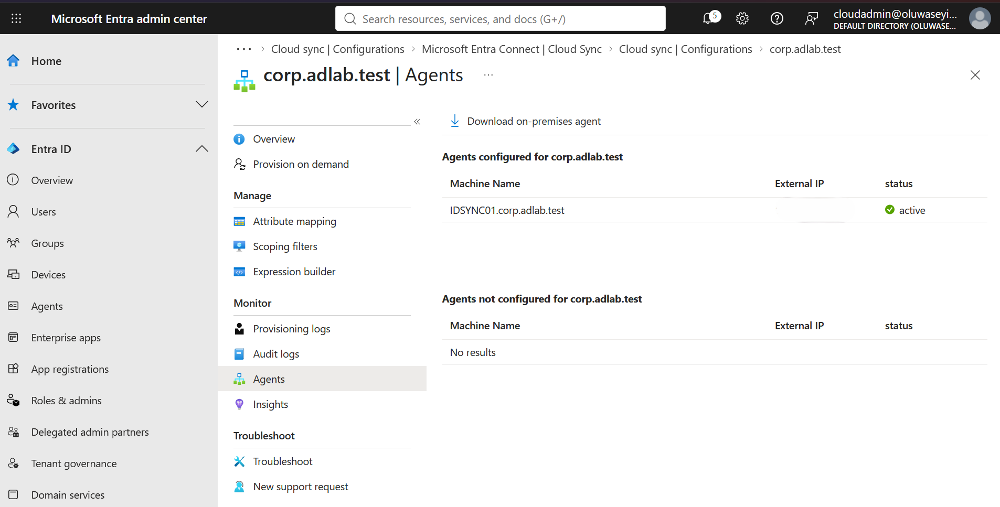
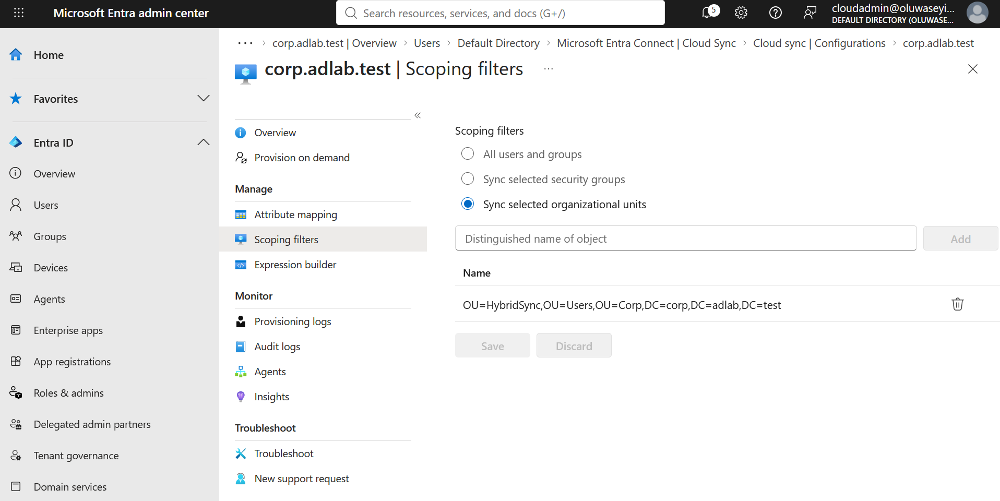
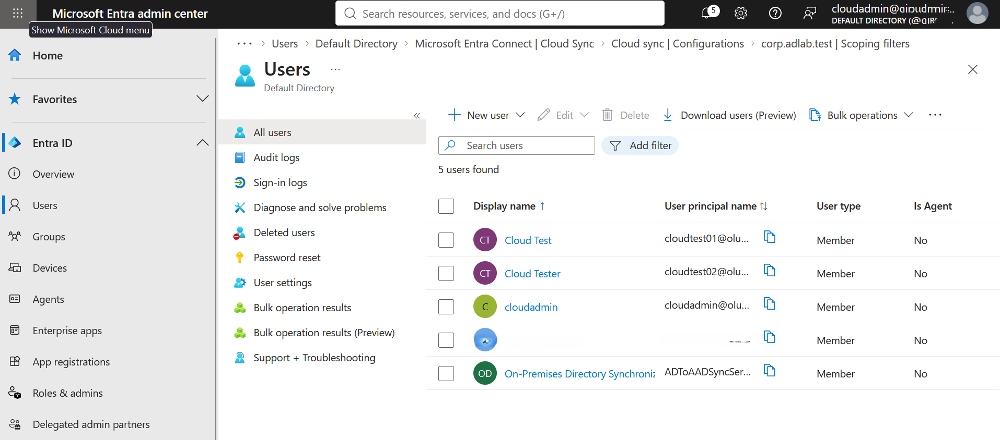
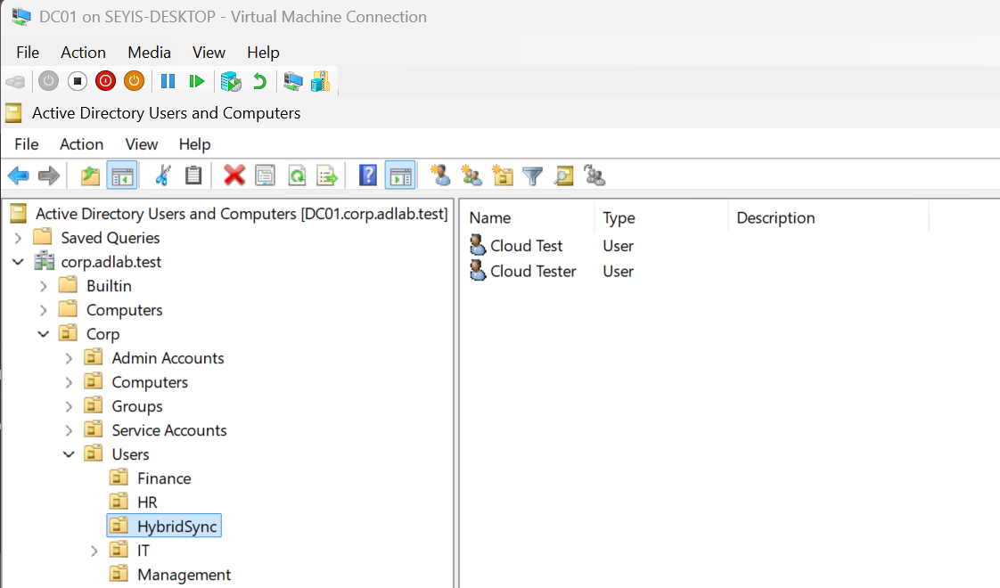
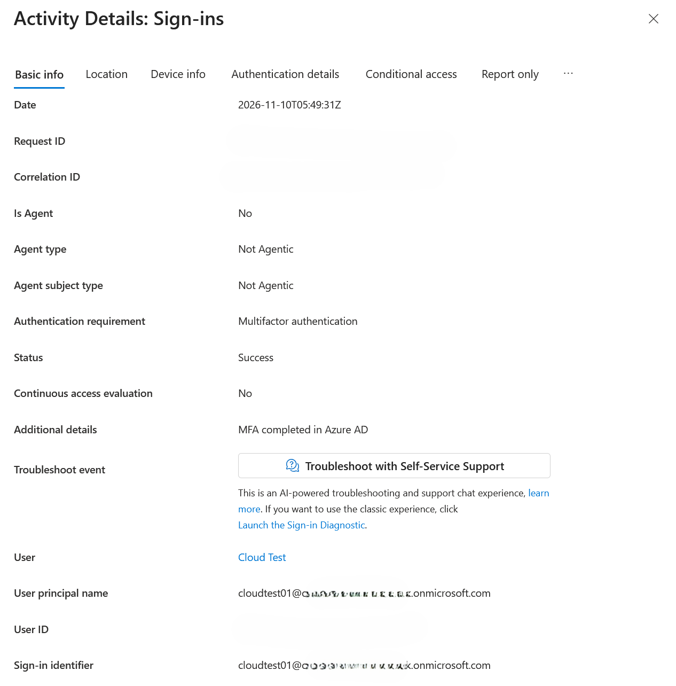

# Hybrid Identity Integration

## Overview

Extended the on-premises Active Directory environment into Microsoft Entra ID using Microsoft Entra Cloud Sync.

This integration demonstrates hybrid identity management between traditional Windows infrastructure and cloud-based identity services.

## Configuration

| Component | Purpose |
|---|---|
| DC01 | On-premises Active Directory |
| IDSYNC01 (`10.10.10.40`, Windows Server 2025) | Microsoft Entra provisioning agent |
| Microsoft Entra ID | Cloud identity management |
| Microsoft Entra Cloud Sync | Directory synchronization |
| corp.adlab.test | On-premises AD domain |

## Implementation

1. Used an existing Microsoft Entra tenant and a cloud administrative account.
2. Deployed a separate domain-joined Windows Server (IDSYNC01) for the Cloud Sync provisioning agent.
3. Installed and registered the Microsoft Entra provisioning agent.
4. Configured synchronization between Active Directory and Microsoft Entra ID.
5. Scoped synchronization to a dedicated `HybridSync` OU, so only intended test accounts reach the cloud and other accounts stay on-premises.
6. Tested provisioning of on-premises Active Directory users.

## Design Notes

**Password hash synchronization:** Synced users sign in to Microsoft Entra ID with their existing on-premises AD password, so they keep one set of credentials for both environments.

## Validation

Cloud Sync agent status:

Synchronization Scope:

Synchronized accounts in the Entra admin center:

On-premises directory objects provisioned into the cloud:

A synced user, `Cloud Test`, signed in to Microsoft Entra ID with their original on-premises password and completed MFA:

