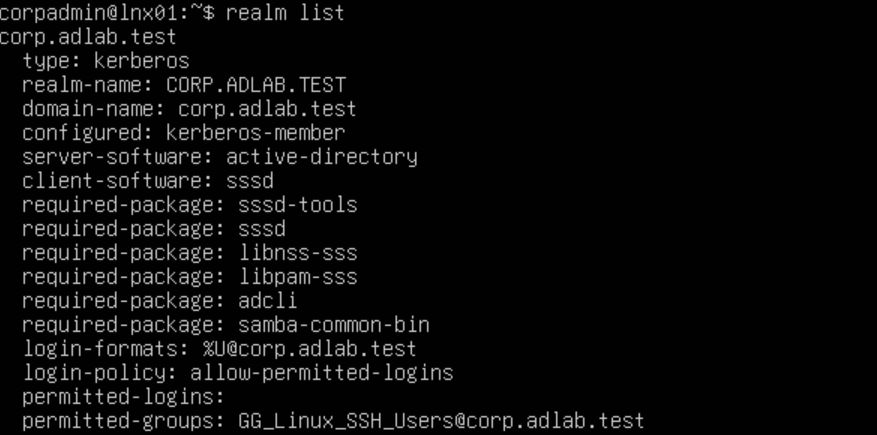
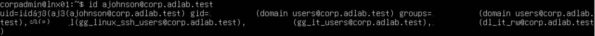

# Linux Server Integration

## Overview

Integrated an Ubuntu Server into the existing Windows Active Directory environment to demonstrate centralized authentication across Windows and Linux systems.

## Configuration

| Setting | Value |
|---|---|
| Hostname | LINUX01 |
| Operating System | Ubuntu Server |
| Hypervisor | Hyper-V |
| Network | 10.10.10.0/24 |
| Domain | corp.adlab.test |
| DNS Server | 10.10.10.10 |

## Implementation

1. Deployed Ubuntu Server on Hyper-V using the `ADLab-Switch` internal network.
2. Configured networking to use DC01 for DNS resolution.
3. Installed `realmd`, `SSSD`, and `adcli` for Active Directory integration.
4. Joined LINUX01 to the `corp.adlab.test` domain.
5. Configured domain user authentication.

## Validation

<table>
  <tr>
    <td width="50%"></td>
    <td width="50%"></td>
  </tr>
  <tr>
    <td align="center"><b>Authorized:</b> A member of the linux SSH security group is able to login to LNX01</td>
    <td align="center"><b>Denied:</b> Another user with no security group membership trying to SSH into LNX01 is denied</td>
  </tr>
</table>

Confirmed that Active Directory accounts could be recognized and authenticated on Ubuntu.