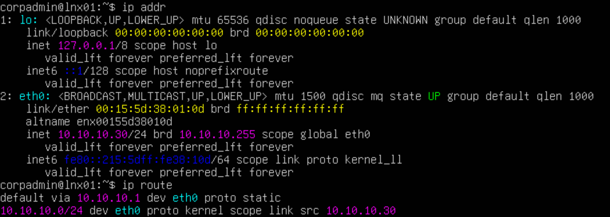
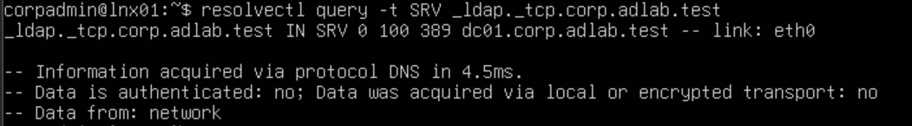

# Linux Server Integration

## Overview

Integrated an Ubuntu Server into the existing Windows Active Directory environment to demonstrate centralized authentication across Windows and Linux systems.

## Configuration

| Setting | Value |
|---|---|
| Hostname | LNX01 |
| IP Address | 10.10.10.30 (static) |
| Operating System | Ubuntu Server 26.04 LTS |
| Hypervisor | Hyper-V |
| Network | 10.10.10.0/24 |
| Domain | corp.adlab.test |
| DNS Server | 10.10.10.10 |

## Implementation

1. Deployed Ubuntu Server on Hyper-V using the `ADLab-Switch` internal network.
2. Assigned a static IP (`10.10.10.30`) with `10.10.10.1` as the gateway and DC01 (`10.10.10.10`) for DNS, then confirmed LNX01 could locate the domain controller through its SRV record.
3. Installed `realmd`, `SSSD`, and `adcli` for Active Directory integration.
4. Joined LNX01 to the `corp.adlab.test` domain.
5. Restricted sign-in to members of the `GG_Linux_SSH_Users` AD group with `sudo realm permit -g GG_Linux_SSH_Users@corp.adlab.test`.

LNX01's static network configuration:

DNS lookup of the domain controller's SRV record from LNX01:

## Validation

Verified domain membership:

Verified that Ubuntu could resolve an Active Directory user:

<table>
  <tr>
    <td width="50%"></td>
    <td width="50%"></td>
  </tr>
  <tr>
    <td align="center"><b>Authorized:</b> <code>ajohnson</code>, a member of <code>GG_Linux_SSH_Users</code>, signs in to LNX01 over SSH</td>
   <td align="center"><b>Denied:</b> <code>jbrown</code>, who is not in <code>GG_Linux_SSH_Users</code>, is refused</td>
  </tr>
</table>

Confirmed that LNX01 resolves AD users and their group memberships, and that SSH access is controlled by AD group membership in the same way RDP access is controlled on the Windows workstations.